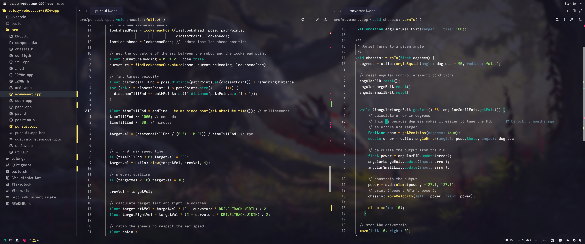

# Derock's Dotfiles

My NixOS configuration lives here. Uses nix flakes. This config serves two hosts, but there are three configs in `./hosts`

| Host | Device | Description |
| --- | --- | --- |
| Galaxy | Laptop | Named galaxy because it's a samsung galaxybook |
| Supernova | Desktop | Named since supernovas are huge explosions, and my desktop is a pretty powerful machine. Big power = big explosion |
| Nebula | Live CD (iso) | Nebulas are where new stars are born, and ISO images are what you use to give life to a computer |

(the little space left of the bar is not visible on the actual screen, i accidentally made screenshot too wide and i cba to fix it 😅)




# Why Nix?
because of its declarative nature, I can easily make configuration changes or install an app on one device and have it on my other device too. This means I basically only have to maintain one system.

## the special stuff
- `pkgs/samsung-galaxybook-extras.nix` - Kernel module derivation that builds the [Samsung Galaxybook platform drivers](https://github.com/joshuagrisham/samsung-galaxybook-extras/tree/main) for fan control among other things.
- `pkgs/intel-ipu6.nix` - My attempt at writing a derivation for Intel's IPU6 drivers. NixOS now has an upstreamed "hardware.ipu6.enable" flag that you should use instead.
- `pkgs/kickoff-dot-desktop.nix` - .desktop file support for the kickoff app

## Building the ISO

as simple as cloning and running `nix build .#nixosConfigurations.nebula.config.system.build.isoImage --show-trace`.  
warning though, it contains all the apps I use so it'll be ~11gb. Minimal version soon:tm:

## Debugging Hyprland crashes

The [Galaxy NVIDIA-to-Intel DMA-BUF investigation](HYPRLAND-DMABUF-INVESTIGATION.md)
records the confirmed export rejection, crash mechanism, attribution limits,
and recommended next steps. Existing cores and live kernel tracing can be
inspected without enabling debug mode or restarting the graphical session.

Set `wm.hyprland.debug.enable = true;` in the host configuration (Galaxy has
an explicit toggle), then rebuild:

```sh
sudo nixos-rebuild switch --flake .#galaxy
```

Log out and back in before reproducing: a config reload cannot replace the
running compositor with the symbol-enabled executable.

Debug mode enables timestamped file/stdout logs, installs GDB and matching
Hyprland/Mesa symbols, and builds hyprexpo against the selected compositor.
It keeps Hyprland's optimized `RelWithDebInfo` build, the same Mesa package,
and the existing plugins/rendering settings. Hyprland and its plugin may
need local builds; Mesa's existing debug output can be fetched from the cache.
Symbols consume additional disk space. This is not an unoptimized `Debug` build,
so some variables may still be reported as optimized out.

For the most useful capture, log out of the graphical session, log in on a TTY
(`Ctrl`+`Alt`+`F3`), then start the session with stdout/stderr saved:

```sh
start-hyprland > "$HOME/hyprland-session.log" 2>&1
```

This also captures Mesa's stderr, which is not necessarily in Hyprland's own log.
Before triggering either app, run these commands in a terminal in that session:

```sh
hyprctl systeminfo > "$HOME/hyprland-systeminfo.txt"
hyprctl plugin list > "$HOME/hyprland-plugins.txt"
hyprctl rollinglog -f > "$HOME/hyprland-live.log" 2>&1
```

After the crash, use a TTY or the next session to find the **Hyprland** PID,
not a client that crashed after losing its Wayland connection:

```sh
coredumpctl list --since "10 minutes ago" --no-pager
coredumpctl info PID --no-pager
coredumpctl debug PID
```

In GDB:

```gdb
set pagination off
set logging file /tmp/hyprland-backtrace.txt
set logging enabled on
bt full
thread apply all bt
```

The fresh login sets `NIX_DEBUG_INFO_DIRS` to the installed symbols. Symbols must
match the exact crashed binaries; the rebuilt Hyprland's symbols will not
symbolize an older Hyprland core. Also save the matching kernel journal
(`journalctl -k -b --since "10 minutes ago" --no-pager`; select the previous boot
if you rebooted). Reports live in `~/.cache/hyprland/`.

Set the toggle back to `false`, rebuild, and start a fresh session to return to
normal mode. Review logs/backtraces before sharing; raw core dumps can contain
credentials and other process memory.

## some of the tech used
- Hyprland
- Waybar
- Hyprlock
- networkmanager
- wofi
- kickoff
- linux with zen kernel patches
- and too much more
